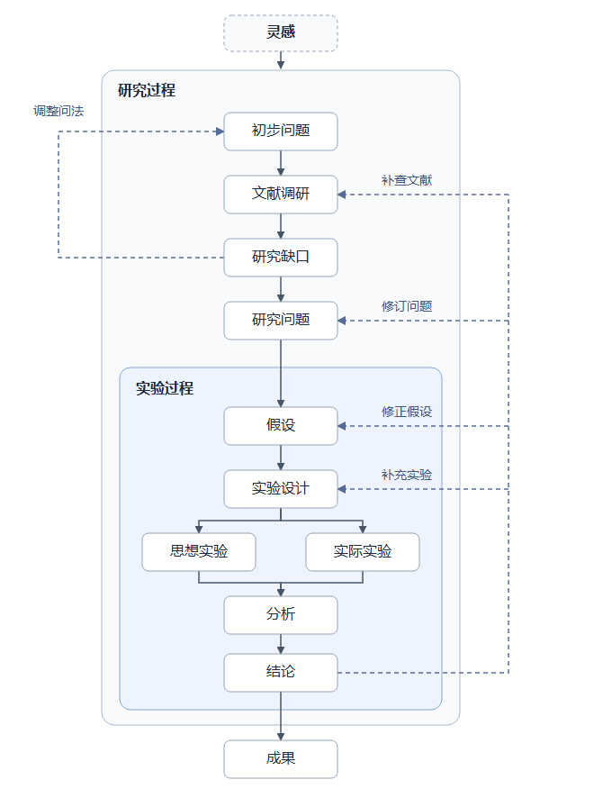

# 研究计划

[English](README.md) | **中文**

将灵感发展为有证据和验证安排的研究计划，适用于文献、理论、复现、方法、Benchmark 和系统研究。
各项内容用于提示研究思路，可以按课题合并、简写或省略不适用部分。基本原则是来源真实、实际工作范围清楚、结论有据可查。AI 检查用于发现重要遗漏，不以填满模板作为推进条件，步骤和精度按问题判断。

## 一、从灵感到成果

### 从哪里开始

**灵感可以在生活和亲身体验的任何一刻出现。** 一次对话、一个日常小麻烦，或一件出乎意料的事，都可以成为起点。记下发生了什么、哪里让你好奇，再写出一个想弄明白的问题。研究中途出现的新灵感，也可以从相关步骤接入。

Agent 在浏览资料、听人讲述经历或分析研究证据时，也要主动找线索。发现反常现象、矛盾或新的联系，就提出初步问题，交代线索从哪来、第一步怎么查证。

### 研究怎样推进



[直接打开流程图](research-flow.png) · [查看 SVG 源图](research-flow.svg)

1. **查清已有证据，界定研究问题。** 先查文献和已有实验记录。现有证据足以回答初步问题，就写出答案和适用范围。还有值得追的缺口，就把它收窄成一个可以验证的研究问题。
2. **设计验证，形成结论。** 写清什么观察会支持或反驳假设。思想实验和实际实验可以择一、并行或接续。探索性研究可以先收集证据，再提出假设。分析后说明证据支持到哪一步，还有哪些不确定。
3. **把结论整理成成果。** 将结论和依据写进论文、研究报告，或保存在带验证记录的代码中。暂时搁置时，也把已有结果和待解决的问题记下来。

### 什么时候往回走

- **调整问法。** 如果原来的问法找不到值得追的缺口，但现象仍值得解释，就回到初步问题，换个角度问。
- **补查文献。** 如果发现遗漏了相关工作，或结果与已有研究冲突，就回到文献调研。
- **修订问题。** 如果发现问题太宽，或现有证据指向更具体的问题，就重新界定研究问题。
- **修正假设。** 如果发现反例或更合理的解释，就回到假设，修正原先的判断。
- **补充实验。** 如果现有证据分不清几种解释，或测量方式需要改进，就回到实验设计。

回到相关步骤后，记下为什么改、下一步要核实什么。各步可以按课题合并或展开，多条研究线也可以并行或接续。

接续已有课题时，先读当前计划和适用规范。可按需传入文献综述、论文分析、已有结果和资源约束。影响路线选择的主张应回到原文、配置或运行记录核对，新增阅读聚焦会影响判断的缺口。修改计划时沿用已确认的优先级，写清已完成事项、剩余事项和本轮拟议变化。

## 二、六个方面怎样串起来

| **方面** | **计划中需要明确的内容** |
| --- | --- |
| 文献调研 | 现有共识、争议、缺口、路线与基线。核心文献提取数据、模型、算法、指标、实验条件、局限和来源定位 |
| 数据 | 来源、使用权限、版本、观测单位、规模与分布、标注、预处理、划分隔离及泄漏风险 |
| 模型 | 表示或假设、输入输出、参数与状态、初始化和版本、模型基线，以及固定与变化部分 |
| 算法 | 训练、推理或求解步骤，相对基线的改动、目标、超参数、随机性、停止规则与代价 |
| 指标 | 主指标和必要约束，定义、单位与方向、聚合、测量条件、不确定性及判定依据 |
| 实验设计 | 每个比较检验哪个问题，处理因素、对照、控制条件、混杂、重复与分析、预算和判读 |

文献为五项技术选择提供依据。数据限定对象与泛化范围，模型表示对象，算法操作或求解模型，指标将目标转为判据，实验设计连接观察与研究问题。设计选择可能改变结论[4]，不同协议的论文数字不能直接作为公平排名。

纯文献调研比较已有证据并提出验证建议，理论研究可用问题实例、数学假设、证明、反例和复杂度或误差界回应相关问题，不适用的细节可以省略。

## 三、实验选择与资源规划

先做小规模正确性检查和必要基线，再投入完整实验。主对照、消融、稳健性和失败分析按研究主张选择，不要求所有课题全部执行。

优先沿用原作者官方代码与配置，记录来源、版本或 commit、许可证及必要适配。找不到官方代码时说明查找情况，使用第三方或自行实现则如实标注。通常大致复现主要数字和趋势、建立基本可信的基线即可，不要求精确对齐全部数字或重跑整篇论文。明显差距影响判断时先排查。

说明实际做到权重评测、训练还是方法生成流程，不能将仅评测作者权重写成已复现训练。消融按问题选择关键组成，从简单设置开始，说明覆盖、作用位置与协议差异，不将不同条件的数字直接归因于算法优劣。关键数字保留原文或结果文件出处，区分计划与实测。

- **统计实验设计（DOE）**：按需使用随机化、分组、全因子或部分因子设计，分析因素主效应与交互，注明混杂限制
- **运筹学（OR）**：将实验选择、预算分配和调度写成决策问题，明确变量、目标、约束与求解方法。仿真优化包含候选排序与选择、评估预算分配[5]
- **贝叶斯优化（BO）**：对昂贵黑箱目标，依据已有试验选择下一组配置，记录搜索空间、初始试验、代理模型、采集函数、噪声与成本处理、预算和停止条件[6]
- **贝叶斯实验设计**：按期望效用选择实验，效用可表达信息获取或决策价值，说明先验、观测模型、效用和约束[7]

寻找更好配置与检验机制采用不同判据。保留自适应搜索轨迹及公平预算口径，用独立评价检查选出的方案。重复查看或多重比较影响推断时说明统计处理。保存失败和负结果，按独立样本单位、预期效应和波动安排重复，避免仅报告最好一次结果。

## 四、可复制的计划模板

未知信息明确标记，章节按需要合并、简写或省略，保留与当前问题有关的联系。

```markdown
# 一、灵感
想法或观察、来源、触发条件、初步问题和预期价值。

# 二、文献调研
范围、关键词、日期、纳入排除规则、核心来源与阅读深度。
逐项提取问题、数据与模型、算法、指标与对照、结果、局限及用途。
选定路线与基线的依据，对灵感的继续、调整或搁置判断。

# 三、研究问题与假设
对象与条件、现有不足、最接近工作、贡献目标和范围。
机制假设或探索问题，可支持和反驳的预测。
六方面怎样共同回答研究问题。

# 四、数据
来源与使用权限、版本、样本单位、规模分布、标注。
预处理和排除规则、划分与隔离、质量与泄漏检查。

# 五、模型
表示与假设、输入输出、参数状态、初始化与版本。
基线，固定与变化部分。

# 六、算法
步骤或公式、相对基线的改动、目标与超参数及搜索方法。
随机性、状态、代价、停止与失败条件。
优先使用的官方实现、来源与版本、必要适配，区分第三方及自行实现。

# 七、指标
主指标与约束：定义、单位方向、聚合、测量实现与条件。
不确定性和判定依据。

# 八、实验设计
每个实验的问题、方法与对照、变化与控制、数据指标、重复分析和预算。
对关键比较，分别写明什么结果支持假设、什么结果构成反例，以及什么情况下证据仍不足以判断。
小规模检查、基线就绪、调参与测试隔离、混杂及替代解释。
代表性复现：主要目标或趋势、来源、关键条件、实际差距与后续安排。
需要精确数值时再细化容差，其他情况以建立基本可信的对照为目标。
按需：DOE 因素，OR 变量目标约束，BO 搜索空间与代理模型、采集函数、
初始试验、噪声、预算，贝叶斯实验设计的先验、观测模型和效用。
搜索轨迹、独立验证、执行顺序和停止规则。
负责人、期限、资源约束和待解决依赖。

# 九、执行与结论
实际运行标识、代码数据模型版本、配置环境、命令和原始制品。
结果波动、失败、假设判断与适用边界、新灵感。
按日期记录计划变更、原因与影响的实验。
```

## 五、在 GitHub 项目里使用

沿用仓库结构，例如将计划放在 `docs/research-plan.md`，由 README 链接。探索 Issue 记录灵感，文献核查后让实现和实验 Issue 关联问题与验证，PR 链接实际检查与结果。源码、配置和制品使用已有工具。

正式运行保留能复查重要结果的代码、数据与模型版本、配置、环境、命令和结果位置，记录粒度按课题需要确定。分别维护计划与执行状态。公开仓库不放私有原始数据和内部文档地址。

## 六、方法论依据

来源于2026年10月14日核验，阅读范围为相关章节或摘要。[1] 的临床专用要求不直接套用到 AI。

1. Ackermann 与 AGA Research Committee（2024），[From the idea to the research question and hypothesis](https://doi.org/10.1007/s00142-024-00682-x)，Arthroskopie，37：232–237。想法、文献、问题与假设章节。
2. Cohen 与 Howe（1988），[How Evaluation Guides AI Research: The Message Still Counts More than the Medium](https://paulrcohen.github.io/papers/952-949-1-PB.pdf)，AI Magazine，9(4)。研究阶段与评价反馈。
3. Forde 与 Paganini（2019），[The Scientific Method in the Science of Machine Learning](https://arxiv.org/abs/1904.10922)，arXiv 立场论文。假设检验与不确定性。
4. Gundersen、Coakley、Kirkpatrick 与 Gil（2022），[Sources of Irreproducibility in Machine Learning: A Review](https://arxiv.org/html/2204.07610v2)，arXiv 综述，第4至9节。设计、算法、观测、评价与文档因素。
5. Amaran、Sahinidis、Sharda 与 Bury（2016），[Simulation optimization: a review of algorithms and applications](https://doi.org/10.1007/s10479-015-2019-x)，Annals of Operations Research，240：351–380。仿真优化、候选选择与预算分配。
6. Frazier（2018），[A Tutorial on Bayesian Optimization](https://arxiv.org/abs/1807.02811)，arXiv 教程。代理模型、采集函数与昂贵评估。
7. Chaloner 与 Verdinelli（1995），[Bayesian Experimental Design: A Review](https://doi.org/10.1214/ss/1177009939)，Statistical Science，10(3)：273–304。决策论与期望效用。
